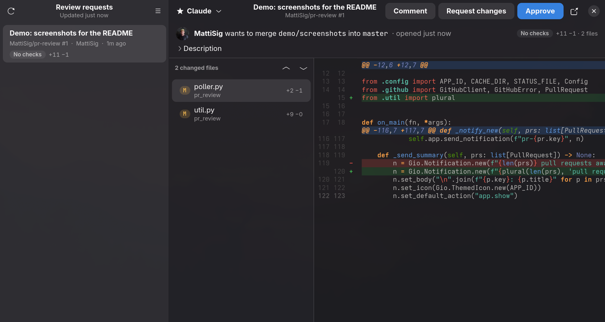

<p align="center">
  
</p>

<h1 align="center">PRewster</h1>

<p align="center">
  <strong>The rooster that crows when a pull request needs your review.</strong><br>
  A native Linux (GTK4 / libadwaita) monitor for GitHub review requests: tray icon, desktop notifications,<br>
  in-app diffs with approve / request changes, and headless Claude Code skills on any PR.
</p>

<p align="center">
  <a href="https://github.com/MattiSig/PRewster/releases"></a>
  <a href="LICENSE"></a>
  
  
  
</p>

---

## Screenshots



The main window: review requests on the left, the selected pull request with its changed files and highlighted diff on the right, and Comment / Request changes / Approve in the header.


The tray icon with the pending-review count badge, next to the usual system icons in waybar.


The desktop notification sent when a new review request appears. Clicking it opens that PR in the app.

## Features

- **Pings you** the moment someone requests your review: a desktop notification with a click-through to the PR, a rooster's crow (quiet in do-not-disturb), and a tray icon whose badge shows how many are waiting.
- **Reads the diff natively**: per-file view, syntax highlighting by language, old/new line numbers and change markers in a gutter, keyboard navigation between files.
- **Reviews from the app**: approve, request changes or comment without opening a browser.
- **Runs Claude Code on the PR**: built-in code review, security review and summary actions, plus your own and the repository's skills, streamed into a panel under the diff. Output can be posted as a comment in one click.
- **Stays out of the way**: a single background process, closing the window just hides it, and everything is configurable in one TOML file.
- **Uses what you already have**: authentication comes from the `gh` CLI, no GitHub App or extra tokens.

## Quick start

Arch Linux (Omarchy and friends):

```
sudo pacman -S --needed python-gobject python-cairo python-requests gtk4 libadwaita gtksourceview5 librsvg github-cli
gh auth login
git clone https://github.com/MattiSig/PRewster.git && cd PRewster
./install.sh
prewster
```

`install.sh` symlinks `prewster` and `prewster-waybar` into `~/.local/bin`, installs a desktop entry and icon, and leaves the checkout in place so `git pull` updates the app. `./install.sh --uninstall` removes them.

Other ways to install:

- **Arch package**: `packaging/arch/PKGBUILD` builds a proper package from a release tag (`makepkg -si` inside that folder).
- **pip / uv**: `pip install --user .` or `uv tool install --python-preference system .` (the GTK bindings must come from your distribution, so use the system Python).

### Autostart (Hyprland)

```
exec-once = uwsm-app -- $HOME/.local/bin/prewster --background
```

## How it works

- **Auth**: uses the token from the `gh` CLI (`gh auth token`). `GITHUB_TOKEN` or `GH_TOKEN` override it if set. Approving needs the `repo` scope, which `gh auth login` grants by default. The token lives only in memory.
- **Polling**: a single background process polls the GitHub search API every `poll_interval` seconds (default 120), sends a desktop notification for each new request, and writes `~/.cache/prewster/status.json`.
- **Tray**: the app registers a StatusNotifierItem (works with waybar's `tray` module, KDE, and other SNI hosts). The icon gets a red count badge when reviews are pending, the tooltip lists them, left click opens the app, middle click refreshes, and the right-click menu lists the PRs plus Open / Refresh / Quit. Set `tray = false` to disable.
- **Waybar module (alternative)**: `prewster-waybar` reads the status file and prints module JSON with the count as text. The app sends `SIGRTMIN+11` to waybar after each poll so it updates instantly.
- **Window**: closing the window hides it; polling continues. Clicking the tray icon, a notification, or running `prewster` again brings it back.

### Waybar

With the tray icon (default) you only need waybar's `tray` module in a modules list. On Omarchy the tray sits inside the `group/tray-expander` hover drawer; replace that entry with `"tray"` in `modules-right` if you want it always visible.

If you prefer a text count in the bar instead, add `"custom/prewster"` to a modules list and define it:

```jsonc
"custom/prewster": {
  "exec": "prewster-waybar",
  "return-type": "json",
  "interval": 30,
  "signal": 11,
  "on-click": "prewster",
  "on-click-right": "xdg-open https://github.com/pulls/review-requested"
}
```

Then in `style.css`:

```css
#custom-prewster { min-width: 12px; margin: 0 7.5px; }
#custom-prewster.idle { opacity: 0.5; }
#custom-prewster.stale, #custom-prewster.error { opacity: 0.3; }
```

Restart waybar afterwards (`omarchy restart waybar` on Omarchy).

## Claude on a pull request

The **Claude** button in the PR header lists what you can run:

- built in: *Code review* (`/code-review N`), *Security review*, *Summarize for review*
- your actions from `[[ai.actions]]` in the config
- your user skills (`~/.claude/skills`, `~/.claude/commands`)
- the repository's own skills (`.claude/skills`, `.claude/commands` in the PR's repo)
- a custom prompt

Each run:

1. finds your local checkout of the repo by origin URL (scanning `search_roots`, or `[ai.repos]` if set), or clones it into `~/.cache/prewster/repos` if you have none
2. fetches the PR head as `refs/prewster/N` and checks it out in a detached worktree under `~/.cache/prewster/worktrees` (your working tree is untouched)
3. runs `claude -p` there with `--output-format stream-json`, streaming text and tool activity into a panel under the diff

Runs keep going if you switch PRs; the panel follows the selected PR. Finished output is saved under `~/.cache/prewster/ai/` and can be posted as a PR comment with one click. *Menu > Clean up Claude worktrees* removes the scratch worktrees and refs.

Claude runs with `--setting-sources user`, so only your own Claude settings and hooks apply and nothing from the PR checkout's `.claude/` directory is loaded. By default it also gets `--permission-mode dontAsk` with a tool allowlist and no MCP servers (see `[ai]` in the config). The allowlist is a prefix match, so entries like `Bash(find:*)` and `Bash(rg:*)` are powerful; trim them if you review PRs from people you don't trust. Set `permission_mode = "acceptEdits"` if a skill needs to write inside the scratch worktree.

Scripting: `gdbus call --session --dest dev.rewster.PRewster --object-path /dev/rewster/PRewster --method org.gtk.Actions.Activate ai-run '[<"owner/repo#N|Code review">]' '{}'` opens that PR and starts the named action.

Set `PREWSTER_DEBUG=1` to log list updates and runs to stderr.

## Configuration

`~/.config/prewster/config.toml` is created on first run:

| key              | default                                               | meaning |
|------------------|-------------------------------------------------------|---------|
| `poll_interval`  | `120`                                                 | seconds between polls |
| `query`          | `is:pr is:open review-requested:@me archived:false`   | GitHub search query |
| `include_drafts` | `false`                                               | list draft PRs too |
| `notify`         | `true`                                                | desktop notifications |
| `sound`          | `rooster`                                             | sound played with a notification: `rooster`, a path to a sound file, or `""` for none |
| `waybar_signal`  | `11`                                                  | RTMIN signal sent to waybar (0 disables) |
| `max_results`    | `50`                                                  | PRs fetched per poll |
| `tray`           | `true`                                                | system tray icon |

`review-requested:@me` includes team review requests. Use `user-review-requested:@me` for direct requests only.

The sound plays once per poll, however many requests arrived, and is skipped while notifications are silenced (mako's `do-not-disturb` mode, dunst or swaync paused, GNOME banners off). It is played with `pw-play`, `paplay` or `canberra-gtk-play`, whichever is installed. `prewster --test-sound` plays the configured sound.

The `[ai]` table configures Claude runs: `claude` (binary), `permission_mode`, `allowed_tools`, `max_turns`, `model`, `mcp`, `search_roots`, `[ai.repos]` (explicit `"owner/repo" = "~/path"` checkouts) and `[[ai.actions]]` entries with `name`, `description` and `prompt` (placeholders `{number} {repo} {title} {url} {base} {head} {author}`; a prompt starting with `/` runs that skill).

## Usage

| action                     | how |
|----------------------------|-----|
| Refresh                    | Ctrl+R |
| Hide window (keep polling) | Ctrl+W or close |
| Quit entirely              | Ctrl+Q or menu > Quit |
| Submit review dialog       | Ctrl+Enter |
| Next / previous file       | Alt+Down / Alt+Up |
| Start hidden               | `prewster --background` |
| Hear the crow              | `prewster --test-sound` |

## Releases

Tagging `vX.Y.Z` on `master` runs the release workflow, which builds the sdist and wheel and publishes a GitHub Release with generated notes. Bump `__version__` in `prewster/__init__.py` and `pkgver` in the PKGBUILD first.

## Layout

```
prewster/
  app.py          Adw.Application, actions, CSS, background mode
  window.py       sidebar list + detail pane
  prdetail.py     PR metadata, file list, review buttons, Claude runs
  diffview.py     per-file diff: language highlighting + line-number/marker gutter
  prlist.py       sidebar rows
  reviewdialog.py approve / request changes / comment / prompt dialog
  skillpicker.py  popover listing available Claude actions
  aipanel.py      streaming output panel
  ai.py           repo lookup, PR worktrees, skill discovery, streaming claude -p runs
  tray.py         StatusNotifierItem + DBusMenu tray icon
  poller.py       polling thread, notifications, status file, waybar signal
  sound.py        notification sound, do-not-disturb check
  github.py       GraphQL search, REST files + reviews
  waybar.py       waybar custom-module output
  config.py       paths and config.toml
  icons/          app icon (SVG)
  sounds/         rooster crow (Ogg Vorbis)
data/             desktop entry
docs/             logo and screenshots
packaging/arch/   PKGBUILD
```

## License

MIT, see [LICENSE](LICENSE). The rooster crow is trimmed from a public domain recording by alys on pdsounds.org ([Wikimedia Commons](https://commons.wikimedia.org/wiki/File:Medium_rooster_crowing.ogg)).
